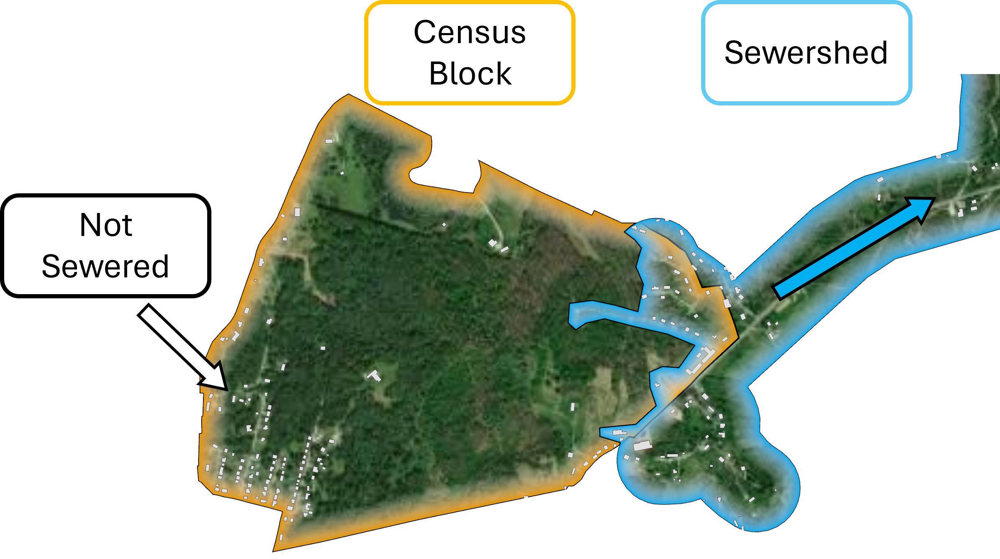

**Current Release: Version 1.3 (Updated October 2026)**

## Version 1.3 Release Notes

Version 1.3 focuses on the **sourced** sewersheds: every sourced boundary now
has a documented source, outdated sources were replaced with newer releases,
new utility boundaries were added, sources judged unreliable were removed,
and the dataset was made free of overlaps.

### At a glance

| | v1.2 | v1.3 |
|---|---|---|
| Sewershed polygons | 17,079 | 17,012 |
| CWNS treatment plants with a sewershed | 17,088 | 17,026 |
| Sourced polygons (plants) | 3,253 | 3,279 (3,293) |
| Share of plants with a sourced boundary | 19% | 19.3% |
| Share of sewered population in sourced sewersheds | – | 45.8% |
| Sourced sewersheds with a documented source | ~2,170 | 3,037 (256 still being researched) |
| Overlapping area between sewersheds | ~7,270 km² | **none** |
| Population in sewersheds (2020, building-weighted) | 240.3 M* | 238.0 M |

\* v1.2 counted people in overlapping sewersheds more than once.

### What changed

**New sourced boundaries.** 270 sewersheds have a boundary that was added or
replaced in v1.3 (`Version_Added = 1.3`). 56 plants that were modeled in
v1.2 now have a sourced boundary. New and replaced sources include:

- **Massachusetts:** all sewersheds replaced with MassDEP's *Estimated Sewer
  System Service Area Boundaries* (MassGIS, PubV2025_10). MassDEP maps each
  town or district collection system separately and names the plant it drains
  to; a plant's sewershed is the union of the collection areas draining to it
  (e.g. 43 areas for MWRA Deer Island). Two Massachusetts towns drain to
  Woonsocket, Rhode Island and are included in its sewershed.
- **New Hampshire:** NH DES water and sewer service areas (sewer-only and
  combined water/sewer areas, merged). Where a merged area is served by more
  than one plant it was split by town. Woodsville was digitized from
  georeferenced maps of its gravity mains provided by the Woodsville Fire
  Department.
- **Sonoma County, CA:** all 10 sourced sewersheds corrected. The v1.2
  polygons were shifted about 130 m west and 40 m north of the source data.
- **Utility and regional data found online:** 34 plants from 23 sources
  (sewer service areas, sewer districts, and sewer lines buffered by 150 m),
  in CO, FL, IN, ME, MS, MT, OH, TX and VA.
- **Hand-digitized or split by EPA:** Lorain County, OH (four plants, split
  from county sewer lines); Opelika, AL (Eastside and Westside); Cary, NC
  (North and South Cary); North Shore Sanitary District, IL (three plants);
  San Antonio, TX (see below).
- **San Antonio, TX:** the San Antonio Water System territory is split between
  its two major plants, Steven M. Clouse (formerly Dos Rios) and Leon Creek.
  **The dividing line was digitized by EPA from the best information
  available and is approximate.** The Martinez I, II, IV and Salitrillo
  service areas come from a separate source, and ten surrounding cities from
  the Texas CCN service-area layer.

**Sources removed.** Polygons judged unreliable on review are no longer
treated as sourced. Their v1.2 polygon is kept, marked `Method = Modeled`
and `Flag = needs_v2_model`, until they can be modeled in version 2:

- **South Carolina (29):** mostly utility service territories much larger than
  the sewered area (e.g. Conway, 1,567 km², holding 25 times its reported
  population).
- **North Port, FL** and **Snyderville Basin – Silver Creek, UT.**

**No more overlaps.** In v1.2 many sewersheds overlapped, mostly because the
modeled polygons are drawn around the hexagons assigned to each plant and
neighbouring outlines crossed. v1.3 resolves every overlap:

1. Sourced boundaries take priority over modeled ones.
2. Where two sourced boundaries overlap: identical polygons are merged into
   one feature listing both plants; a polygon inside another is cut out of the
   larger one (the smaller system keeps its area); thin slivers along shared
   edges are removed from the larger polygon; other partial overlaps are split
   at the line halfway between the two plants.
3. Where modeled sewersheds overlap, the overlap is split at the line halfway
   between the plants.
4. A small piece of a modeled sewershed that was cut off from the rest is
   given to the modeled sewershed it borders, or removed if it was cut off by a
   sourced sewershed.

As a result, 68 small modeled sewersheds that lay entirely inside a sourced
sewershed no longer have a polygon (mostly single hexagons), and some modeled
outlines changed where they met a neighbour.

**Source documentation.** `sources.csv` now lists the source of **every**
sourced sewershed (3,293 plants), not only recent additions. 256 sourced
sewersheds from v1.0 still have no recorded source and are listed as
"Unknown (being researched)".

### Files

`Version_1_3.gdb` (EPSG:4326) contains:

**Sewersheds** — one polygon per sewershed.

| Column | Description |
|---|---|
| CWNS_ID | 2022 CWNS identifier of the treatment plant. A polygon shared by several plants lists all of them, separated by `; ` |
| FACILITY_NAME | Treatment plant name(s) as reported in the CWNS |
| STATE_CODE, State | State of the treatment plant (2-letter code, name) |
| CITY | City of the treatment plant as reported in the CWNS |
| RESIDENTIAL_POP_2022 | Residential population served by the plant (**not** including plants that discharge to it), CWNS |
| TOTAL_RES_POPULATION_2022 | Residential population served by the plant **including** plants that discharge to it, CWNS |
| Method | `Sourced` (boundary from a state, utility or other source) or `Modeled` (EPA model) |
| Flag | `needs_v2_model`: former sourced boundary judged unreliable; v1.2 polygon kept until it is modeled in version 2 |
| Min_Prob, Mean_Prob | Modeled sewersheds: lowest and mean model probability of the hexagons in the sewershed |
| Pop_2020 | Estimated 2020 population in the sewershed (building-weighted census blocks; see Census Crosswalk Files). 0 where the polygon holds no buildings or people |
| Buildings | Buildings ≥ 40 m² in the sewershed (Microsoft building footprints) |
| Version_Added | Version in which the current boundary was added |
| Source_Dataset | Identifier of the source dataset (see `sources.csv`) |
| Source | URL of the source, where public |
| Geometry_From | How the v1.3 geometry was built: `v12` (unchanged sourced boundary), `v12_kept` (kept after review), `ma_dep_crosswalk`, `nh_des_crosswalk`, `link_review` (new online source), `v1_3_owner_layer` (digitized or split by EPA), `source_feature` (taken directly from the source), `v12_modeled`, `v12_flagged` |
| NPDES_ID | NPDES permit number(s) of the plant |
| ECHO_URL | Link to the plant's ECHO Detailed Facility Report |

**Endpoints** — CWNS treatment plant locations, unchanged from v1.2.

`sources.csv` — one row per sourced CWNS_ID.

| Column | Description |
|---|---|
| CWNS_ID | Unique identifier for each POTW (sewershed) |
| POTW_Name | The POTW name as listed in the CWNS |
| Source_Name | Name of the data source |
| How_Obtained | How the data was obtained (public download / email / feedback) |
| Source_Path | URL (if applicable) that data was retrieved from |
| Feature_Type | Type of data: `sewershed_polygon` (service area drawn for the system), `sewered_area` (sewered land, not separated by utility), `service_territory` (legal or planning territory, e.g. districts, CCNs), `sewer_lines` (buffered by 150 m), `digitized_map`, `census_place` |
| Method | Method used to derive the service area |
| Date_Obtained | Date EPA obtained the data |
| Version_Added | First version in which the plant's sewershed was sourced |
| Dataset_ID | Identifier of the source dataset (matches `Source_Dataset` in the geodatabase) |

### Census Crosswalk Files

Crosswalks link every sewershed to the census geographies it covers, at three
levels: **blocks**, **block groups** and **tracts** (2020 Census geography;
2022 planning-region GEOIDs for Connecticut). They are in `crosswalks/`
(the block file is split into four parts because of its size).

#### Why buildings instead of area

The usual way to apportion a census unit that is only partly inside a
sewershed is by area: if 40% of a block's area is in the sewershed, 40% of its
people are assumed to be. That fails wherever people are not spread evenly,
which is almost everywhere a sewer boundary cuts through a block: half of a
block may be woods and half a subdivision, and the sewer serves the
subdivision.

We weight by **buildings** instead. Microsoft building footprints of at least
40 m² (roughly a two-car garage, so sheds are excluded) are reduced to their
centroids. Each building falls in exactly one census block and in at most one
sewershed. A block's population is then split in proportion to its buildings:
if 45 of a block's 50 buildings are inside a sewershed, 90% of the block's
population is assigned to that sewershed.



Blocks that have population but **no building footprints at all** (gaps in the
footprint data, very new development) fall back to area weighting, so their
population is not lost. These rows are marked `Weight_Method = area` (about
4.1 million people, 1.7% of the sewered population).

#### Two multipliers

Each row gives two multipliers, because census variables count two different
things: **people** (and households) and **structures**.

| Column | Use it for | Block | Block group / tract |
|---|---|---|---|
| `Population_Multiplier` | Variables that count people or households (population, age, race, income, ACS estimates…) | Share of the block's population in the sewershed | `Population` ÷ total population of the block group / tract |
| `Building_Multiplier` | Variables that count structures (housing units, buildings) | Share of the block's buildings in the sewershed | Buildings in the sewershed ÷ all buildings in the block group / tract |

To estimate any census variable for a sewershed, multiply each unit's value by
the matching multiplier and sum over the units:

```
estimate(sewershed) = Σ over units [ value(unit) × multiplier(unit, sewershed) ]
```

At the **block** level the two multipliers are the same number whenever the
block has buildings, because population is split by buildings. They differ
only for area-weighted blocks (`Building_Multiplier` is empty) and for blocks
with buildings but no population (`Population_Multiplier` is empty).

At the **block group and tract** levels they differ on purpose. The
`Population` column is **built up from blocks**: it is the sum of the
building-weighted populations of every block in the unit that touches the
sewershed. That is more accurate than applying one share to the whole unit,
because a block group or tract is large and more likely to extend well
outside the sewershed, so a single unit-wide building share would assume
people are spread evenly across it. `Population_Multiplier` is defined so that
`Population_Multiplier × unit population = Population` exactly, which carries
this block-level accuracy over to any person-based variable you apply it to.
`Building_Multiplier` is the plain building share of the unit, which is the
right weight for structure-based variables.

#### Crosswalk column descriptions

| Column | Description |
|---|---|
| `CWNS_ID` | Sewershed identifier (2022 CWNS). A polygon shared by several plants lists all of them, separated by `; ` |
| `GEOID` | Census block (15 digits), block group (12) or tract (11) GEOID |
| `Population` | Estimated 2020 population of the sewershed / census unit pair (building-weighted; summed from blocks at block group and tract level) |
| `Buildings` | Count of buildings ≥ 40 m² in the sewershed / census unit pair |
| `Population_Multiplier` | Share of the unit's population in the sewershed (see above). Empty if the unit has no population |
| `Building_Multiplier` | Share of the unit's buildings in the sewershed. Empty if the unit has no buildings |
| `Weight_Method` | `buildings`; `area` (block with population but no building footprints); `mixed` (block group / tract containing both kinds of blocks) |

#### Crosswalk notes

- **Changed from v1.2:** the single `Crosswalk_Multiplier` is replaced by
  `Population_Multiplier` and `Building_Multiplier`, and `Weight_Method` is
  new. In v1.2, `Crosswalk_Multiplier` was the building share at every level.
- **No double counting.** v1.3 sewersheds do not overlap, so for any census
  unit the multipliers across all sewersheds sum to at most 1. (In v1.2,
  overlapping sewersheds let about 112,000 blocks sum to more than 1.)
- **Sewersheds that cross a state line** (174, e.g. Blue Plains, which serves
  Washington, DC and much of suburban Maryland) are crosswalked in every state
  they reach. In v1.2 only the plant's own state was counted.
- The part of a unit not covered by any sewershed is not in the files: it is
  `1 − Σ multipliers` for that unit.

### Known limitations

- 256 sourced sewersheds from v1.0 have no recorded source yet.
- The San Antonio split between Steven M. Clouse and Leon Creek is
  approximate.
- Some sourced boundaries are legal or planning territories (sewer districts,
  certificated service areas) rather than mapped sewered areas; see
  `Feature_Type` in `sources.csv`.
- 31 sewersheds are flagged `needs_v2_model` and keep a polygon judged
  unreliable until version 2.
- 884 modeled sewersheds (mostly a single hexagon at the plant) contain no
  buildings or people (`Pop_2020 = 0`).
